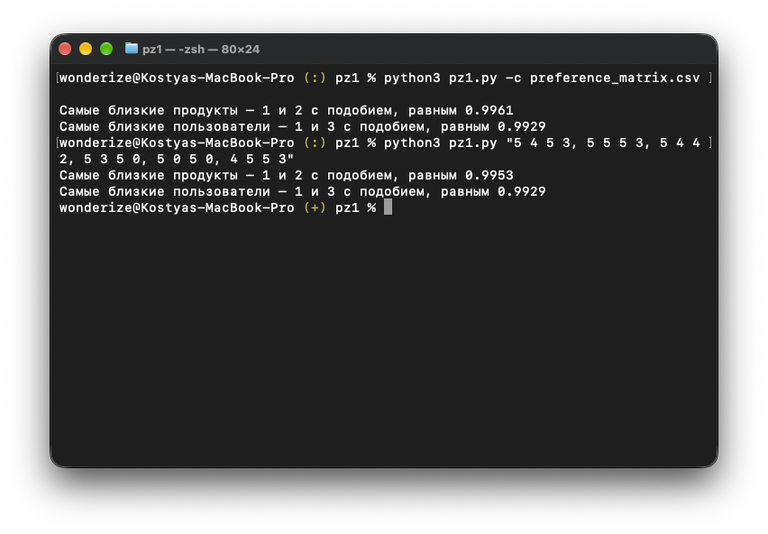

# Практическая работа №1

## Скриншоты



## Запуск

```bash
# Для считывания таблицы из CSV (строки – продукты, колонки – пользователи)
python3 pz1.py -c example.csv

# Для ввода матрицы в качестве аргумента программы (строки матрицы разделены запятой)
python3 pz1.py "1 2 3 4, 5 6 7 8, 9 10 11 12, 13 14 15 16"
```
