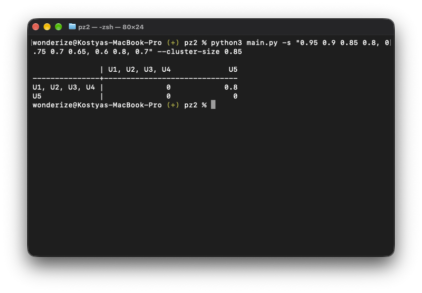

# Практическая работа №2

## Скриншоты



## Запуск

```bash
# Считать матрицу из CSV-файла и найти максимум
# с заданным размером кластера
python3 main.py -c example.csv --cluster-size 0.74

# Считать матрицу из ввода терминала и найти максимум
python3 main.py --cluster-size 0.74 "1 0 2, 2 3 1, 2 3 1"

# Передать только элементы над главной диагональю
# (для упрощения ручного ввода матрицы, в примере
# матрица размерностью 5x5)
python3 main.py -s "1 3 4 3, 5 5 3, 5 8, 2" --cluster-size 0.74
```
