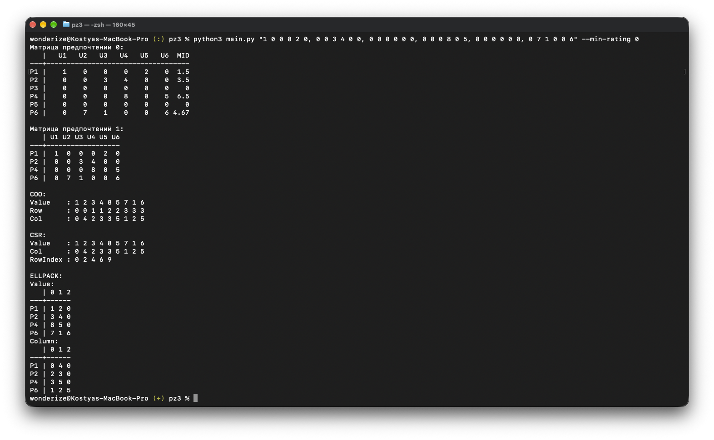

# Практическая работа №3

## Скриншоты



## Запуск

```bash
# Обработать матрицу предпочтений из задания
python3 main.py

# Считать матрицу из CSV-файла и исключить товары
# со средним рейтингом ниже заданного
python3 main.py -c example.csv --min-rating 4

# Считать матрицу из ввода терминала
# (строки — товары, столбцы — пользователи)
python3 main.py "5 4 0, 0 0 0, 3 5 0" --min-rating 4
```
