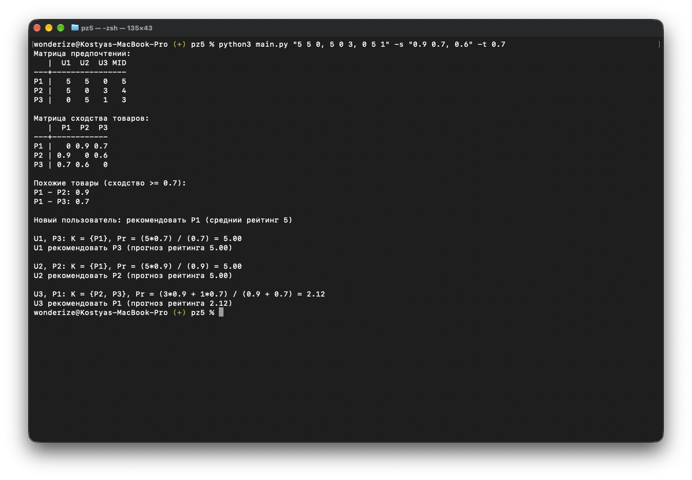

# Практическая работа №5

## Скриншоты



## Запуск

```bash
# Матрица предпочтений и матрица сходства товаров из задания
python3 main.py

# Считать матрицу предпочтений из CSV-файла
# (строки — товары, столбцы — пользователи),
# матрица сходства задается элементами над главной диагональю
python3 main.py -c example.csv -s "0.9 0.7, 0.6"

# Считать матрицу предпочтений из ввода терминала
# и задать порог сходства товаров (по умолчанию 0.85)
python3 main.py "5 5 0, 5 0 3, 0 5 1" -s "0.9 0.7, 0.6" -t 0.7
```
