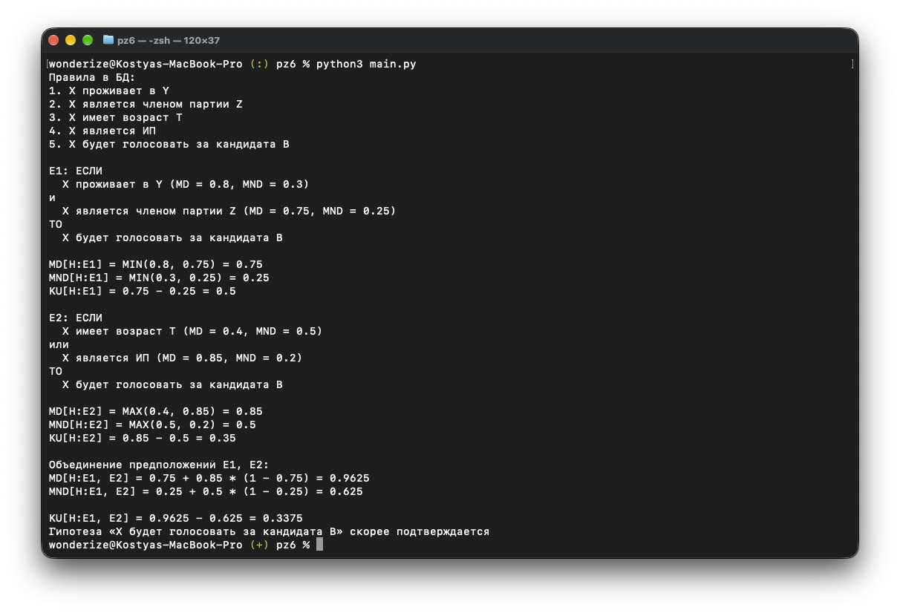

# Практическая работа №6

## Скриншоты



## Запуск

```bash
# Предположения E1, E2 из задания
python3 main.py

# Задать свои предположения в виде "N(MD, MND) and|or [not] N(MD, MND)",
# где N — номер правила в БД (1–4)
python3 main.py "1(0.9, 0.1) or 2(0.6, 0.3)" "not 4(0.3, 0.6)"

# Рассчитать только одно предположение
python3 main.py -1 "3(0.7, 0.2) and 4(0.5, 0.4)"
```
